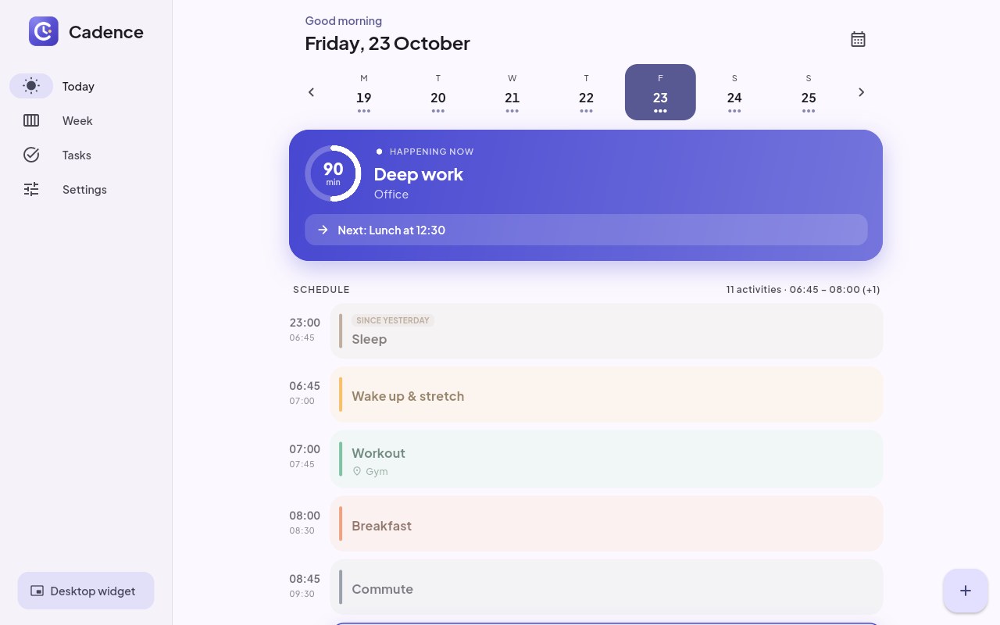
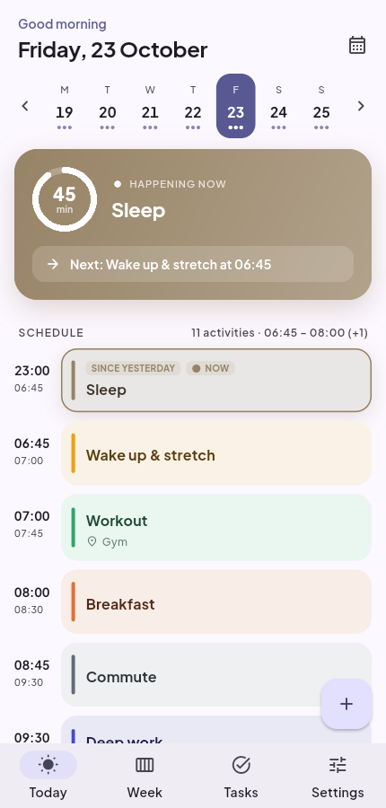

<div align="center">


# Cadence

**Your timetable and daily routine, always a glance away.**

A free, open-source planner for **Windows, Linux and Android** with home-screen and desktop widgets, reminders, alarms and focus time — built for real college timetables (lab groups, electives, “Saturday follows Monday”) and just as happy running your working week.

[](https://github.com/ToshikSoni/TimeTable-Widget/actions/workflows/ci.yml)
[](https://github.com/ToshikSoni/TimeTable-Widget/releases/latest)
[](LICENSE)


> **Early preview (0.x).** Cadence is usable day to day, but features and file formats may still change before 1.0.

[**Download**](#download) · [Features](#features) · [User guide](docs/USER_GUIDE.md) · [Contributing](CONTRIBUTING.md)


</div>

## Why Cadence?

Most timetable apps assume every week looks the same and every student attends every class. Real timetables don't work like that: labs are split into batches, you pick one of two electives, a festival cancels Tuesday, and three Saturdays a semester “follow Monday's timetable”. Cadence understands all of that.

It works just as well outside college. Plan your working week — deep work, meetings, gym, commute, sleep — with blocks that cross midnight, an alarm on the ones that matter, and Do Not Disturb while you focus. Either way, what's next is always on your home screen, your desktop and in a notification before it starts.

No account, no ads, no tracking. Your data stays on your device as a single JSON file you can back up or share.

## Features

**See your day at a glance**
- **Today** view with a live “happening now” card, countdown ring, what's next, free periods and breaks.
- **Week** grid that looks like the printed timetable — with lunch bands, a moving “now” line, parallel classes side by side, and an agenda view for small screens.
- **Widgets everywhere** — two resizable home-screen widgets on Android (*Up next* and *Today*), and a compact desktop widget on Windows and Linux that can float on top or sit on the desktop behind your windows.

**Plan your day, not just your classes**
- **Routines** for work and life: give every activity its own colour, place and note.
- Blocks that **run past midnight** — sleep from 23:30 to 07:00 just works, and shows up “since yesterday” the next morning.
- **Per-activity alerts**: pick the reminder time, make it **ring as an alarm**, or **silence your phone** (Do Not Disturb, Android) while it runs.
- Coming from the *TimeTable* Android app? Import its `.tta` backup directly.

**Never miss a thing**
- Reminders a few minutes before each class or activity (per-subject / per-entry override or opt-out), plus an optional “starting now” ping.
- **Wake-up alarm** before your first class of the day, full-screen with snooze — it skips holidays and days without classes automatically.
- A morning summary: “5 classes today, 09:30 – 17:30, first up: Cloud Security in BYOD Lab”.
- **Starts with Windows / your Linux session** and lives in the system tray, so reminders keep coming.

**Built for real timetables**
- **Lab groups / batches** (G1, G2…): pick yours and only your labs appear.
- **Electives**: switch off the subjects you don't take.
- **Holidays** and **special days** — including working Saturdays that follow another weekday's timetable.
- One-off **cancellations** and **extra classes**.
- A **bell schedule** (periods and breaks) so adding a class is a single tap; double-length labs in two taps.
- Multiple timetables (one per semester, or per section if you teach).

**Stay on top of things**
- **Attendance tracker** with a target (75% by default): tick ✓ or ✕ on a class and Cadence tells you how many more you can skip — or how many you need to attend to get back on track.
- **Tasks & exams** linked to subjects, with due-date reminders, overdue highlighting and swipe-to-complete.

**Your data, your way**
- **Share a timetable** with classmates as a small file — one person types it in, everyone imports it.
- Full **backup & restore**, **export to calendar** (.ics for Google Calendar, Outlook, Thunderbird…) and **save the week as an image**.
- Light, dark and system themes, accent colours, Material You on Android 12+, 12/24-hour clock.

## Screenshots

| Daily routine (desktop) | Routine on a phone, early morning |
| --- | --- |
|  |  |

| Week | Attendance | Tasks |
| --- | --- | --- |
|  |  |  |

| Desktop widget | Phone · Today (dark) | Phone · Week (dark) | First launch |
| --- | --- | --- | --- |
|  |  |  |  |

## Download

Grab the latest version from the [**Releases page**](https://github.com/ToshikSoni/TimeTable-Widget/releases/latest).

| Platform | File | How to install |
| --- | --- | --- |
| **Windows 10/11** | `Cadence-x.y.z-windows-x64-setup.exe` | Run it. Installs per-user, no admin needed. |
| | `Cadence-x.y.z-windows-x64-portable.zip` | Unzip anywhere and run `cadence.exe`. |
| **Android 7+** | `Cadence-x.y.z-android-arm64-v8a.apk` | Most phones from the last few years. |
| | `Cadence-x.y.z-android-universal.apk` | Works on every device if unsure. |
| **Ubuntu, Debian, Linux Mint, Pop!_OS, elementary** | `cadence_x.y.z_amd64.deb` | `sudo apt install ./cadence_x.y.z_amd64.deb` |
| **Fedora, RHEL / Alma / Rocky, openSUSE** | `cadence-x.y.z-1.x86_64.rpm` | `sudo dnf install ./cadence-x.y.z-1.x86_64.rpm` (openSUSE: `sudo zypper install ./…rpm`) |
| **Arch, Manjaro, EndeavourOS** | `cadence-bin-x.y.z-1-x86_64.pkg.tar.zst` | `sudo pacman -U ./cadence-bin-x.y.z-1-x86_64.pkg.tar.zst` |
| **Any other Linux** | `Cadence-x.y.z-x86_64.AppImage` | `chmod +x` it and double-click. |
| | `Cadence-x.y.z-linux-x64.tar.gz` | Plain bundle; extract and run `./cadence`. |

`SHA256SUMS.txt` is attached to every release if you want to verify your download.

> **Windows SmartScreen** may warn that the installer is from an unknown publisher, because the build isn't code-signed. Choose *More info → Run anyway*.
>
> **Android** will ask you to allow installing apps from your browser or file manager the first time.

## Getting started

1. Open Cadence and pick what you want to plan: **My classes**, **My work & daily routine**, one of the examples, or **Import a file**.
2. For classes, pick your **lab group** and switch off **electives** you don't take. For routines, tap any activity to set its reminder, alarm or Do Not Disturb.
3. Allow notifications. On the desktop, leave **Start with Windows** on so reminders work after a restart.
4. Add the widget: on Android long-press the home screen → *Widgets* → *Cadence*; on the desktop press **Desktop widget** in the sidebar (or the tray menu).

The [user guide](docs/USER_GUIDE.md) walks through everything else, including how to type in a timetable quickly.

### Keyboard shortcuts (desktop)

| Shortcut | Action |
| --- | --- |
| <kbd>Ctrl</kbd> + <kbd>1</kbd> … <kbd>5</kbd> | Today, Week, Tasks, Attendance, Settings |
| <kbd>Ctrl</kbd> + <kbd>Shift</kbd> + <kbd>W</kbd> | Toggle the desktop widget |
| Long-press on the week grid | Add a class at that time |

## Building from source

You need [Flutter](https://docs.flutter.dev/get-started/install) 3.47 or newer.

```bash
git clone https://github.com/ToshikSoni/TimeTable-Widget.git
cd TimeTable-Widget
flutter pub get
flutter run -d linux      # or: -d windows, or an Android device id
```

Linux additionally needs `libgtk-3-dev libx11-dev libxi-dev libgstreamer1.0-dev libgstreamer-plugins-base1.0-dev`; Windows needs Visual Studio 2022 with *Desktop development with C++*. See [CONTRIBUTING.md](CONTRIBUTING.md) for details, project layout and how releases are cut.

## Privacy

Cadence works fully offline. It has no analytics, no ads and no servers. Everything is stored in one file on your device (`cadence.json` in the app's data folder) and only leaves it when *you* export or share it.

See the full [privacy policy](PRIVACY.md).

## Contributing

Bug reports, ideas and pull requests are very welcome — see [CONTRIBUTING.md](CONTRIBUTING.md). Please be kind; this project follows the [Contributor Covenant](CODE_OF_CONDUCT.md). Security issues: see [SECURITY.md](SECURITY.md).

## License

[MIT](LICENSE) © 2026 Toshik Soni. The bundled Plus Jakarta Sans font is licensed under the [SIL Open Font License](assets/fonts/OFL.txt).
