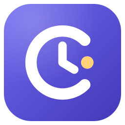
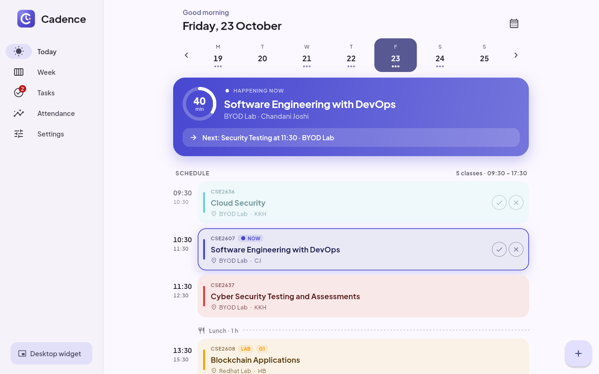
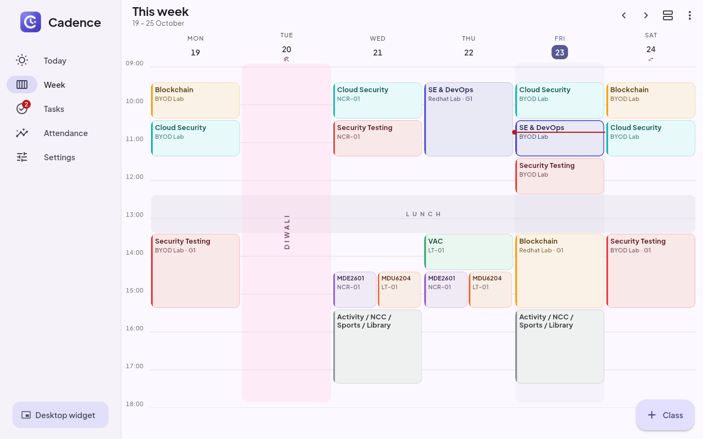
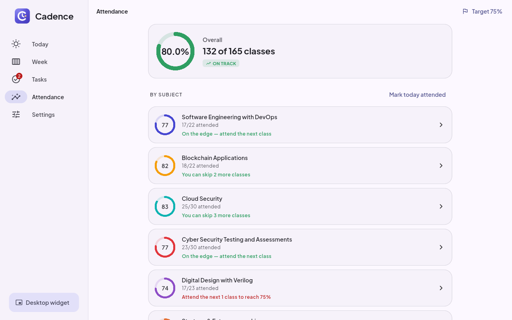
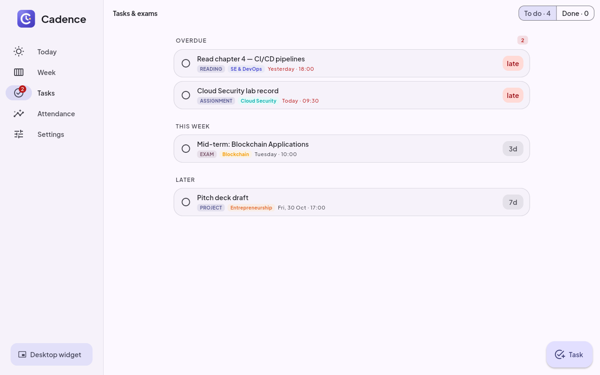
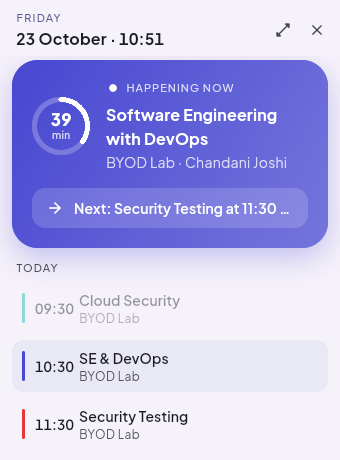
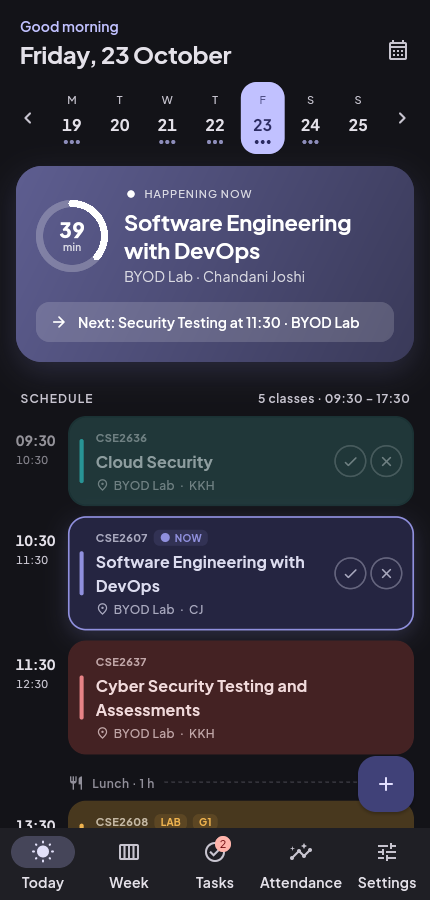
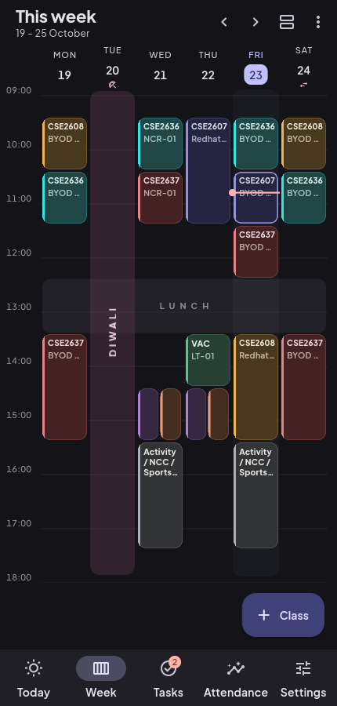
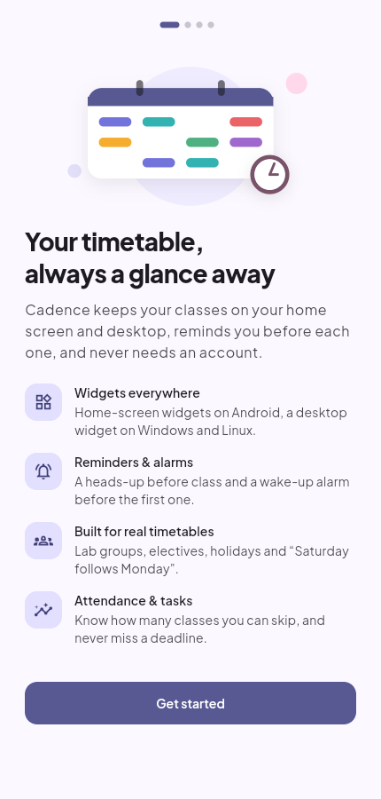

<div align="center">



# Cadence

**Your class timetable, always a glance away.**

A free, open-source timetable app for **Windows, Linux and Android** with home-screen and desktop widgets, class reminders, a wake-up alarm, attendance tracking and tasks — built for real college timetables with lab groups, electives and “Saturday follows Monday” days.

[](https://github.com/ToshikSoni/TimeTable-Widget/actions/workflows/ci.yml)
[](https://github.com/ToshikSoni/TimeTable-Widget/releases/latest)
[](LICENSE)


[**Download**](#download) · [Features](#features) · [User guide](docs/USER_GUIDE.md) · [Contributing](CONTRIBUTING.md)



</div>

## Why Cadence?

Most timetable apps assume every week looks the same and every student attends every class. Real timetables don't work like that: labs are split into batches, you pick one of two electives, a festival cancels Tuesday, and three Saturdays a semester “follow Monday's timetable”. Cadence understands all of that, then gets out of your way — the next class is always on your home screen, your desktop and in a notification ten minutes before it starts.

No account, no ads, no tracking. Your data stays on your device as a single JSON file you can back up or share.

## Features

**See your day at a glance**
- **Today** view with a live “happening now” card, countdown ring, what's next, free periods and breaks.
- **Week** grid that looks like the printed timetable — with lunch bands, a moving “now” line, parallel classes side by side, and an agenda view for small screens.
- **Widgets everywhere** — two resizable home-screen widgets on Android (*Up next* and *Today*), and a compact desktop widget on Windows and Linux that can float on top or sit on the desktop behind your windows.

**Never miss a class**
- Reminders a few minutes before each class (per-subject override or opt-out), plus an optional “class is starting” ping.
- **Wake-up alarm** before your first class of the day, full-screen with snooze — it skips holidays and days without classes automatically.
- A morning summary: “5 classes today, 09:30 – 17:30, first up: Cloud Security in BYOD Lab”.
- **Starts with Windows / your Linux session** and lives in the system tray, so reminders keep coming.

**Built for real timetables**
- **Lab groups / batches** (G1, G2…): pick yours and only your labs appear.
- **Electives**: switch off the subjects you don't take.
- **Holidays** and **special days** — including working Saturdays that follow another weekday's timetable.
- One-off **cancellations** and **extra classes**.
- A **bell schedule** (periods and breaks) so adding a class is a single tap; double-length labs in two taps.
- Multiple timetables (one per semester, or per section if you teach).

**Stay on top of things**
- **Attendance tracker** with a target (75% by default): tick ✓ or ✕ on a class and Cadence tells you how many more you can skip — or how many you need to attend to get back on track.
- **Tasks & exams** linked to subjects, with due-date reminders, overdue highlighting and swipe-to-complete.

**Your data, your way**
- **Share a timetable** with classmates as a small file — one person types it in, everyone imports it.
- Full **backup & restore**, **export to calendar** (.ics for Google Calendar, Outlook, Thunderbird…) and **save the week as an image**.
- Light, dark and system themes, accent colours, Material You on Android 12+, 12/24-hour clock.

## Screenshots

| Week | Attendance | Tasks |
| --- | --- | --- |
|  |  |  |

| Desktop widget | Phone · Today (dark) | Phone · Week (dark) | First launch |
| --- | --- | --- | --- |
|  |  |  |  |

## Download

Grab the latest version from the [**Releases page**](https://github.com/ToshikSoni/TimeTable-Widget/releases/latest).

| Platform | File | Notes |
| --- | --- | --- |
| **Windows 10/11** | `Cadence-x.y.z-windows-x64-setup.exe` | Recommended. Installs per-user, no admin needed. |
| | `Cadence-x.y.z-windows-x64-portable.zip` | Unzip anywhere and run `cadence.exe`. |
| **Android 7+** | `Cadence-x.y.z-android-arm64-v8a.apk` | Most phones from the last few years. |
| | `Cadence-x.y.z-android-universal.apk` | Works on every device if unsure. |
| **Ubuntu / Debian** | `cadence_x.y.z_amd64.deb` | `sudo apt install ./cadence_x.y.z_amd64.deb` |
| **Any Linux** | `Cadence-x.y.z-x86_64.AppImage` | `chmod +x` it and double-click. |
| | `Cadence-x.y.z-linux-x64.tar.gz` | Plain bundle; run `./cadence`. |

`SHA256SUMS.txt` is attached to every release if you want to verify your download.

> **Windows SmartScreen** may warn that the installer is from an unknown publisher, because the build isn't code-signed. Choose *More info → Run anyway*.
>
> **Android** will ask you to allow installing apps from your browser or file manager the first time.

## Getting started

1. Open Cadence. Choose **Use the example** to explore, **Start fresh**, or **Import a file** a classmate shared.
2. Pick your **lab group** and switch off **electives** you don't take.
3. Allow notifications. On the desktop, leave **Start with Windows** on so reminders work after a restart.
4. Add the widget: on Android long-press the home screen → *Widgets* → *Cadence*; on the desktop press **Desktop widget** in the sidebar (or the tray menu).

The [user guide](docs/USER_GUIDE.md) walks through everything else, including how to type in a timetable quickly.

### Keyboard shortcuts (desktop)

| Shortcut | Action |
| --- | --- |
| <kbd>Ctrl</kbd> + <kbd>1</kbd> … <kbd>5</kbd> | Today, Week, Tasks, Attendance, Settings |
| <kbd>Ctrl</kbd> + <kbd>Shift</kbd> + <kbd>W</kbd> | Toggle the desktop widget |
| Long-press on the week grid | Add a class at that time |

## Building from source

You need [Flutter](https://docs.flutter.dev/get-started/install) 3.47 or newer.

```bash
git clone https://github.com/ToshikSoni/TimeTable-Widget.git
cd TimeTable-Widget
flutter pub get
flutter run -d linux      # or: -d windows, or an Android device id
```

Linux additionally needs `libgtk-3-dev libx11-dev libxi-dev libgstreamer1.0-dev libgstreamer-plugins-base1.0-dev`; Windows needs Visual Studio 2022 with *Desktop development with C++*. See [CONTRIBUTING.md](CONTRIBUTING.md) for details, project layout and how releases are cut.

## Privacy

Cadence works fully offline. It has no analytics, no ads and no servers. Everything is stored in one file on your device (`cadence.json` in the app's data folder) and only leaves it when *you* export or share it.

## Contributing

Bug reports, ideas and pull requests are very welcome — see [CONTRIBUTING.md](CONTRIBUTING.md). Please be kind; this project follows the [Contributor Covenant](CODE_OF_CONDUCT.md). Security issues: see [SECURITY.md](SECURITY.md).

## License

[MIT](LICENSE) © 2026 Toshik Soni. The bundled Plus Jakarta Sans font is licensed under the [SIL Open Font License](assets/fonts/OFL.txt).
